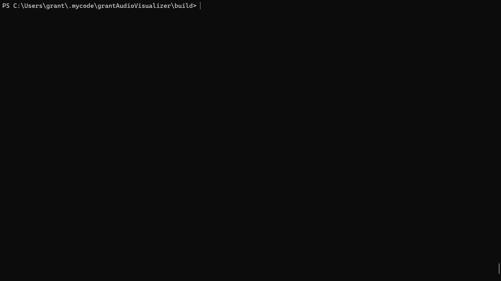

# Real-Time Audio Visualizer

A cross-platform audio visualization application that renders frequency spectrum analysis in real-time using OpenGL and PortAudio.


*32-band frequency spectrum visualization*

## Features

- **Real-time frequency analysis** using FFT (Fast Fourier Transform)
- **32 logarithmic frequency bands** (20Hz - 16kHz) for balanced visualization
- **GPU-accelerated rendering** with OpenGL 3.3 Core Profile
- **Multi-format support**: MP3, WAV, FLAC via libsndfile
- **Native file dialog** for easy audio file selection
- **Resizable window** with responsive visualization

## Technical Highlights

### Architecture
- **Four-thread design**: a main thread (window/input events only), a dedicated render thread (FFT analysis + drawing, runs independently of the OS's window message loop so resizing/dragging the window never freezes the visualization), a background audio-fill thread (keeps the playback buffer topped up), and PortAudio's own real-time audio callback thread
- **Lock-free audio pipeline**: audio samples flow through a single-writer/single-reader ring buffer (PortAudio's `PaUtilRingBuffer`) with no mutexes; cross-thread signals (stop flags, live FPS stats) use `std::atomic` instead of locks
- **Efficient GPU rendering**: Instanced drawing reduces 32 bars to a single draw call

### Audio Processing
- **FFT Size**: 1024 samples
- **Window Function**: Hanning window for reduced spectral leakage
- **Frequency Buckets**: 32 logarithmically-spaced bands
- **Analysis Rate**: ~60 Hz (synchronized with rendering)

### Rendering
- **Custom GLSL shaders** for vertex transformation and fragment coloring
- **Instanced rendering** for optimal performance
- **Live FPS/frame-time counter** shown in the window title, measured each second from actual frame timing (not a fixed target)
- **Built-in performance instrumentation**: per-stage timing (FFT / draw / vsync wait / buffer fill) and audio underrun counts each second, plus whole-run frame-time percentiles on exit (see [Performance](#performance))

## Dependencies

- **C++17** compiler
- **CMake** 3.16 or higher
- **vcpkg** for package management

### Libraries (via vcpkg)
- `glfw3` - Window and input management
- `glad` - OpenGL loader
- `portaudio` - Cross-platform audio I/O
- `libsndfile` - Audio file loading
- `fftw3f` - Fast Fourier Transform implementation
- `tinyfiledialogs` - Native file dialogs

## Building from Source

### Prerequisites

1. Install [vcpkg](https://github.com/microsoft/vcpkg):
```bash
git clone https://github.com/microsoft/vcpkg.git
cd vcpkg
./bootstrap-vcpkg.sh  # or bootstrap-vcpkg.bat on Windows
```

2. Install dependencies:
```bash
vcpkg install glfw3 glad portaudio libsndfile fftw3 tinyfiledialogs
```

### Compile

```bash
# Clone repository
git clone https://github.com/grantjlk/grantAudioVisualizer.git
cd grantAudioVisualizer

# Create build directory
mkdir build && cd build

# Configure with CMake (adjust vcpkg path as needed)
cmake .. -DCMAKE_TOOLCHAIN_FILE=/path/to/vcpkg/scripts/buildsystems/vcpkg.cmake

# Build (add --config Release for an optimized build - on multi-config
# generators like Visual Studio, --config defaults to Debug otherwise)
cmake --build . --config Release
```

### Run

```bash
# From build directory
./AudioVisualizer  # Linux/macOS
Release\AudioVisualizer.exe  # Windows (or Debug\AudioVisualizer.exe for a debug build)

# Optionally pass a file to skip the file dialog
Release\AudioVisualizer.exe ..\assets\sweeptest.mp3
```

## Usage

1. Launch the application
2. Select an audio file using the file dialog
3. Watch the frequency spectrum visualize your audio in real-time!
4. Check the window title bar for live measured FPS and frame time
5. Press **ESC** or close the window to exit

## How It Works

### Audio Pipeline

1. **Audio Loading**: `AudioLoader` uses libsndfile to decode audio files into raw PCM samples
2. **Buffering**: `AudioBuffer` maintains a thread-safe ring buffer for seamless playback
3. **Playback**: `AudioOutput` streams audio through PortAudio's callback system
4. **Analysis**: `AudioAnalyzer` performs FFT on audio data, converting time-domain samples to frequency spectrum
5. **Visualization**: `Visualizer` renders frequency buckets as dynamic bars using OpenGL

### FFT Analysis

- Applies **Hanning window** to reduce spectral leakage
- Computes **1024-point FFT** on audio samples
- Converts complex output to magnitude spectrum
- Groups magnitudes into **32 logarithmic buckets** for perceptually-balanced visualization
- Calculates **RMS** and **peak amplitude** for future features

### Rendering Pipeline

- **Vertex Shader**: Transforms single quad geometry into 32 positioned bars
- **Fragment Shader**: Applies solid color
- **Smoothing**: Exponential moving average prevents jittery motion

## Performance

Measured with the app's built-in instrumentation on a Release build.

**Test machine:** AMD Ryzen 5 7535U, integrated Radeon graphics, 16 GB RAM, Windows 11, 60 Hz display, MSVC 2022

| | Normal playback | Dragging/resizing the window |
|---|---|---|
| Run | 3:52 song, 13,921 frames | 36 s sweep, 2,499 frames |
| Frame time p50 | 16.69 ms | 16.32 ms |
| Frame time p99 | 18.33 ms | 32.72 ms |
| Frame time p99.9 | 20.35 ms | 51.12 ms |
| Frame time max | 38.25 ms | 101.78 ms |
| Audio underruns | **0** | **0** |

**Per-frame work:** FFT analysis ~0.025 ms and draw ~0.023 ms (CPU side), so about 0.05 ms of real work per 16.7 ms frame (~0.3% of the frame budget). The rest is waiting on vsync.

**Findings:**
- Audio never dropped out, even while the window was being dragged and resized. Buffer filling and playback run on their own threads, so the OS's window move/resize loop can't starve them.
- Frame pacing gets uneven during a drag/resize, but the visualization never freezes. Analysis and draw times stay flat the whole time; the spikes are all inside `glfwSwapBuffers`, where the driver and compositor are recreating the window surface. Before rendering moved to its own thread, the visualization froze completely while the window was held.
- Frame time is reported as percentiles rather than an average, since averages hide stutters and FPS is pinned to the refresh rate by vsync.

**Reproduce** (from the build directory):
```bash
Release\AudioVisualizer.exe ..\assets\sweeptest.mp3
```
Each second the console prints a `[Perf]` line, and a run summary with p50/p99/p99.9/max frame time and total underruns prints on exit. Any audio file works; longer files give more reliable percentiles (the normal-playback numbers above came from a full-length song).

## Future Enhancements

- [ ] Live microphone input support
- [ ] Multiple visualization modes (waveform, circular spectrum, etc.)
- [ ] Dynamic color schemes based on amplitude/frequency
- [ ] Playback controls (play/pause, seek, volume)
- [ ] Audio effects (equalizer, reverb)
- [ ] Export visualization as video

## Author

**Grant LeRette-Kauffman**
- GitHub: [@grantjlk](https://github.com/grantjlk)
- Email: grantjlk@gmail.com
